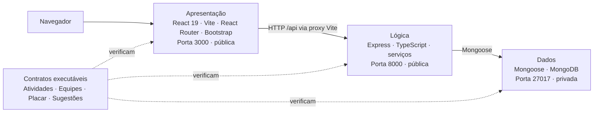

# Arquitetura do OctoFit Tracker

O OctoFit Tracker é uma aplicação de três camadas para um programa de atividades físicas escolar. O código inicial inclui contratos de API e pontos de implementação intencionalmente incompletos para que você use o modo agent do GitHub Copilot em um ciclo guiado por testes.

## Limites entre as camadas

- **Camada de apresentação**: React 19, Vite, React Router, Bootstrap e um cliente compartilhado da API em `octofit-tracker/frontend/src`.
- **Camada de lógica**: rotas e serviços Express com TypeScript em `octofit-tracker/backend/src` expõem o comportamento `/api/*` na porta `8000`.
- **Camada de dados**: modelos Mongoose e dados de demonstração em `octofit-tracker/backend/src/models` e `src/scripts/seed.ts` são persistidos no MongoDB na porta `27017`.

## Portas e regras de ambiente

- MongoDB: `27017` (privada)
- API Express: `8000` (pública)
- Interface Vite: `3000` (pública)
- O navegador acessa caminhos relativos `/api`. O Vite os encaminha para `http://localhost:8000`; `VITE_API_BASE_URL` pode substituir a URL-base.
- Não encaminhe nem torne públicas outras portas.

## Contrato da API

| Capacidade | Método e caminho | Comportamento esperado |
| --- | --- | --- |
| Registro de atividades | `GET /api/activities`, `POST /api/activities` | Lista e cria atividades válidas. POST recebe `userId`, `teamId`, `type` e `minutes`; `userId` e `teamId` devem ser IDs bem-formados de uma pessoa e uma equipe existentes, caso contrário a API retorna um 4xx intencional (nunca um 500 causado por erro de conversão). Uma atividade criada armazena `user`, `team`, `type` e `minutes` enviados, além de `points` e `occurredAt` calculados. |
| Equipes | `GET /api/teams`, `POST /api/teams` | Lista e cria equipes com integrantes. As equipes criadas e listadas mantêm os valores enviados em `name` e `mascot`. Rejeita uma equipe sem nome com `400`. |
| Placar | `GET /api/leaderboard` | Retorna as equipes ordenadas pela soma dos pontos de suas atividades, da maior para a menor. Cada item contém `teamName`, `totalPoints` e uma `rank` iniciada em 1. |
| Sugestões de treino | `GET /api/workouts/suggestions/:userEmail` | Recomenda treinos com base nos padrões de atividade recentes da pessoa correspondente ao e-mail seed. O foco da primeira sugestão (`focus`) corresponde à meta ou à atividade recente dessa pessoa, e o campo `reason` explica o motivo. Um e-mail sem pessoa correspondente retorna um 4xx intencional (por exemplo, `404`). |

## Decisões de implementação

### Por camada

- Decisão da camada de apresentação: as páginas só consomem o cliente compartilhado da API. Cada página implementa os estados de carregamento (`role="status"`), vazio e erro (`role="alert"`) antes de renderizar os dados. Nenhuma página acessa o MongoDB ou calcula pontos.
- Decisão da camada de lógica: as rotas delegam às funções de serviço. Entradas inválidas são rejeitadas com `400` (dados ausentes) ou `4xx` (IDs malformados ou inexistentes), nunca com `500`. Não há autenticação neste exercício.
- Decisão da camada de dados: validações obrigatórias nos modelos Mongoose (`User`, `Team`, `Activity`, `Workout`). Os dados são criados pelo código da aplicação e pelo `seed.ts`, sem scripts diretos no MongoDB.

### Por capacidade

- Abordagem para registro de atividades: `POST /api/activities` valida que `userId` e `teamId` são ObjectIds de registros existentes e que `teamId` é a equipe atual da pessoa; caso contrário responde `4xx`. `occurredAt` é opcional e, quando ausente, recebe a data atual. `points` é calculado no serviço, não enviado pelo cliente.
- Abordagem para gerenciamento de equipes: `POST /api/teams` exige `name` e rejeita ausência com `400`. `mascot` e os integrantes são persistidos como enviados. `GET /api/teams` lista as equipes com integrantes.
- Abordagem para o placar: agregação no MongoDB pela soma de `points` das atividades de cada equipe, em ordem decrescente, com `rank` iniciando em 1. Equipes sem atividades aparecem com `totalPoints` 0.
- Abordagem para sugestões de treino: o serviço localiza a pessoa pelo e-mail (`404` se não existir), calcula o padrão recente de atividades e retorna `focus` e `reason` coerentes com a meta ou a atividade recente.

### Relacionamentos

- **Pertencimento a equipe**: `User.team` é a fonte de verdade. `Team.members` é sincronizado pela camada de serviço ao criar ou trocar a equipe de uma pessoa, e o seed segue a mesma regra.
- **Equipe da atividade**: a atividade guarda a equipe do momento do registro (histórico). Se a pessoa trocar de equipe, as atividades anteriores continuam atribuídas à equipe original, e o placar soma por essa equipe.
- **Regras de validação**: `User.email` e `Team.name` são únicos. `User.fitnessGoal` e `Workout.focus` aceitam `endurance`, `strength` ou `mobility`. `Activity.type` aceita `run`, `cycle`, `walk` ou `strength`. `Workout.difficulty` aceita `easy` ou `moderate`. `minutes` fica entre 1 e 1440. `points` é no mínimo 0.
- **Pontos**: no MVP, `points` = `minutes` da atividade, calculado no serviço e nunca enviado pelo cliente.

### Ordem de implementação

1. Dados
2. API (equipes, atividades, placar, sugestões)
3. Frontend
4. Compilação

Cada etapa só começa com os testes da etapa anterior passando.

## Plano de testes

| Suíte | Comando | Estado inicial | Significado das falhas |
| --- | --- | --- | --- |
| Dados | `npm run test:data --prefix octofit-tracker/backend` | 4 de 5 falham | Os modelos não têm validação obrigatória: `validateSync()` não retorna erro para `name`, `email`, `fitnessGoal`, `mascot`, `type`, `user`, `team`, `focus`, `minutes` e `difficulty`. O teste de inserção idempotente do seed já passa. |
| API | `npm run test:api --prefix octofit-tracker/backend` | 4 de 4 falham | `POST /api/teams` responde `501` (rota não implementada) em vez de `400`. `GET /api/leaderboard` retorna `[]` porque a agregação não existe. A sugestão de treino não traz `reason`. |
| Frontend | `npm test --prefix octofit-tracker/frontend` | 15 de 15 falham | As páginas exibem o placeholder "Implementação pendente" e não têm os estados de carregamento, vazio e erro nem a renderização dos dados da API. |
| Compilação do backend | `npm run build --prefix octofit-tracker/backend` | não executada | — |
| Compilação do frontend | `npm run build --prefix octofit-tracker/frontend` | não executada | — |

Critério de conclusão: os três conjuntos de testes passam e as duas compilações terminam sem erro.
